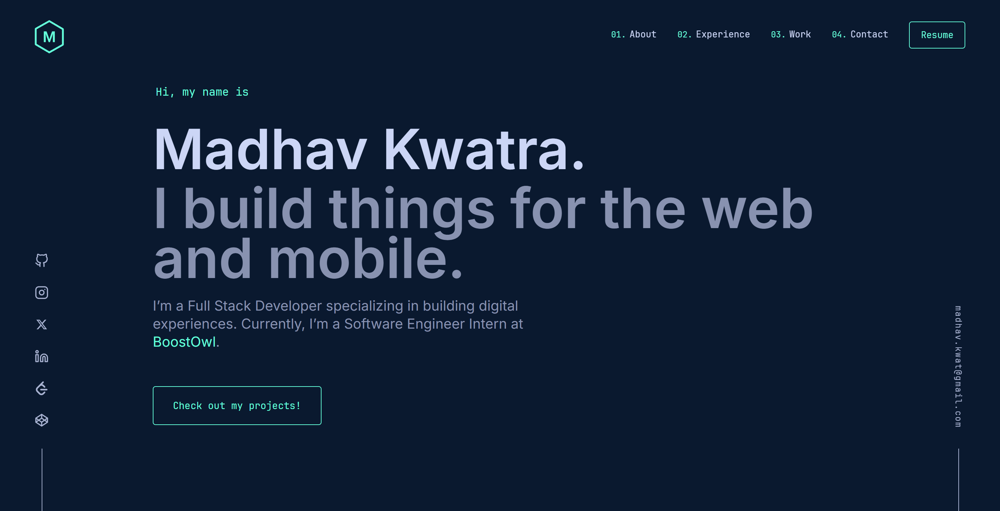

<div align="center">
  
</div>
<h1 align="center">
  Portfolio Site
</h1>
<p align="center">
  My personal website at <a href="https://madhavkwatra.in" target="_blank">madhavkwatra.in</a> built with <a href="https://www.gatsbyjs.org/" target="_blank">Gatsby</a> and hosted with <a href="https://www.netlify.com/" target="_blank">Netlify</a>
</p>
<p align="center">
  <a href="https://app.netlify.com/sites/madhavkwatra/deploys" target="_blank">
    
  </a>
</p>



## 🙏 Credit

The design started from [Brittany Chiang's v4](https://github.com/bchiang7/v4). If you fork this repo, please credit her by linking back to [brittanychiang.com](https://brittanychiang.com), or fork her repo directly.

## 🛠 Set up

1. Use the Node version in `.nvmrc` (22.13.0), for example with [NVM](https://github.com/nvm-sh/nvm): `nvm install`
2. Install dependencies: `npm install`
3. Start the dev server: `npm start` (http://localhost:8000)

## 🚀 Production build

```sh
npm run build   # static build into public/
npm run serve   # preview it at http://localhost:9000
```

Netlify deploys `main` to [madhavkwatra.in](https://madhavkwatra.in) and builds a deploy preview for each pull request.

## 🗂 Where things are

- `content/`: projects (`featured/`, `projects/`), jobs (`jobs/`) and the PhoneRecap legal text (`legal/phonerecap/`)
- `src/components/sections/`: home page sections. `src/pages/`: pages. `src/config.js`: socials, nav and analytics settings
- `resume/resume.html`: source of `static/resume.pdf` (see Resume below)
- `tools/checks/`: checks for the PhoneRecap pages (see below)
- `CLAUDE.md`: working rules for Claude Code in this repo

## ✅ Checks

- **Git hooks (Husky):** pre-commit runs Prettier and ESLint on staged files. Pre-push checks the PhoneRecap legal text, then runs `npm run build` unless only docs or tools changed. Skip once with `SKIP_PREPUSH=1 git push`.
- **PhoneRecap legal text:** `node tools/checks/legal-sync.js` checks that `content/legal/phonerecap/*.md` matches the app repo (`../phone-wrapped-app`, or set `PHONERECAP_APP_REPO`). Google Play links to these pages, so the text must stay exact.
- **PhoneRecap pages in a browser** (needs Microsoft Edge): run `npm install --prefix tools/checks` once, then `npm run build && npm run serve`, and in another terminal:

  ```sh
  node tools/checks/legal-pages.js        # privacy + terms: same text, no trackers, no cookies
  node tools/checks/phonerecap-pages.js   # /phonerecap/ + /thanks/: images, form, no trackers
  ```

  Both take an optional base URL (default `http://localhost:9000`) and save screenshots to `scratch/screenshots/`.

## 📈 Analytics

- **Simple Analytics** (`gatsby-plugin-simple-analytics`) is cookieless and always on.
- **Google Analytics 4** and **Microsoft Clarity** set cookies. Logic in `src/utils/analytics.js`, UI in `src/components/cookieBanner.js`, settings in `src/config.js` → `analytics`:
  - **EEA, UK and Switzerland** need opt-in consent. There, an _Accept / Decline_ banner shows, and both tools load only after _Accept_.
  - **Everywhere else**, a notice with an opt-out is enough. Both tools load at once, with a _Got it / Opt out_ notice.
  - The region is guessed from the device time zone (a static site has no IP lookup). As a safety net by IP, Google denies analytics cookies for `consentRegions` until consent, and Clarity does the same by itself for EEA/UK/CH.
  - Visitors can change their choice on `/privacy`.
- To turn a tool off, empty its ID in `src/config.js`. With both IDs empty, no banner shows.

One-time settings in the tools themselves:

- **GA4**: Admin → Data collection and modification → **Data retention** → set event data retention to **14 months**. The default is 2 months, and the change is not retroactive. Leave **Enhanced measurement** on: it tracks page changes, outbound clicks, file downloads (resume) and scrolling.
- **Clarity**: no extra setup is needed. Recordings are kept for 30 days and heatmaps for 13 months.

> Revisit around **May 2027**, when the main duties of India's DPDP Rules start. Analytics cookies may then need consent in India too; add `'IN'` to `consentRegions` and Indian time zones to the consent check if so.

## 📄 Resume

`static/resume.pdf` is generated from [`resume/resume.html`](resume/resume.html) (the `resume/` folder is not published). Edit the HTML, then print it with headless Microsoft Edge from the repo root:

```sh
"/c/Program Files (x86)/Microsoft/Edge/Application/msedge.exe" --headless --disable-gpu --no-pdf-header-footer   --print-to-pdf="$(cygpath -w "$PWD/static/resume.pdf")"   "file:///$(cygpath -m "$PWD/resume/resume.html" | sed 's/ /%20/g')"
```

Check that it is still one page, `grep -a -o '/Count [0-9]*' static/resume.pdf` must print `/Count 1`, and that it reads in order: `pdftotext -layout static/resume.pdf -`.

## 🎨 Color Reference

| Color          | Hex       |
| -------------- | --------- |
| Navy           | `#0a192f` |
| Light Navy     | `#112240` |
| Lightest Navy  | `#233554` |
| Slate          | `#8892b0` |
| Light Slate    | `#a8b2d1` |
| Lightest Slate | `#ccd6f6` |
| White          | `#e6f1ff` |
| Green          | `#64ffda` |
