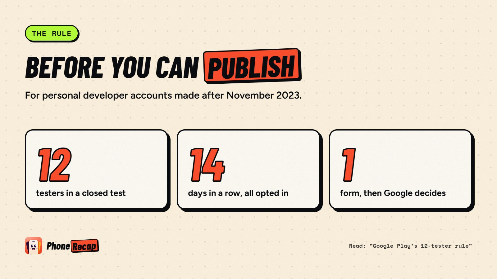
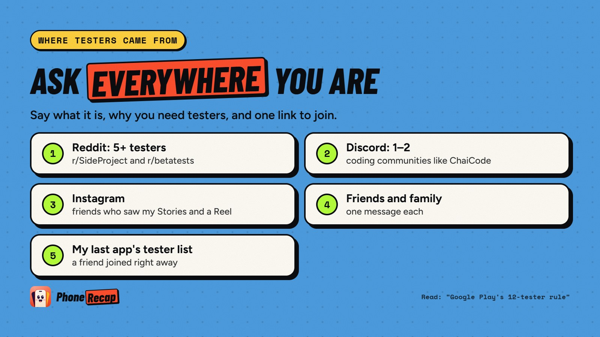
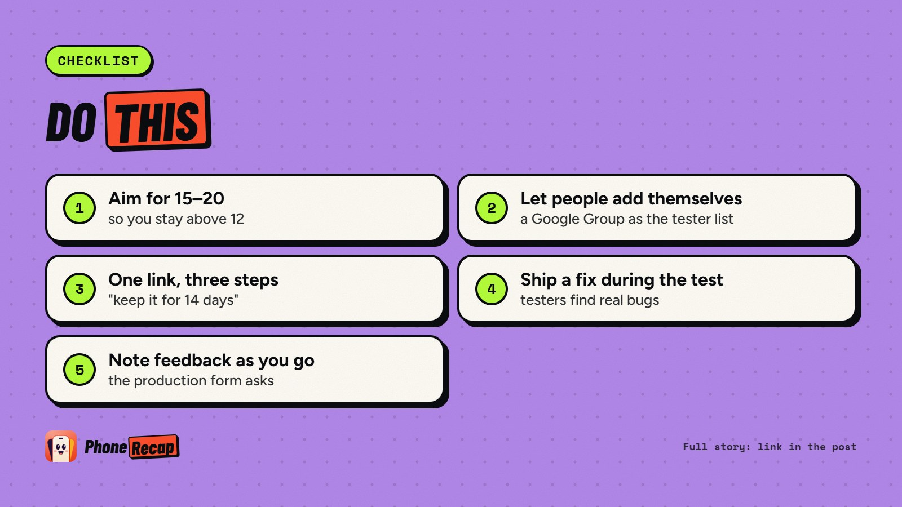
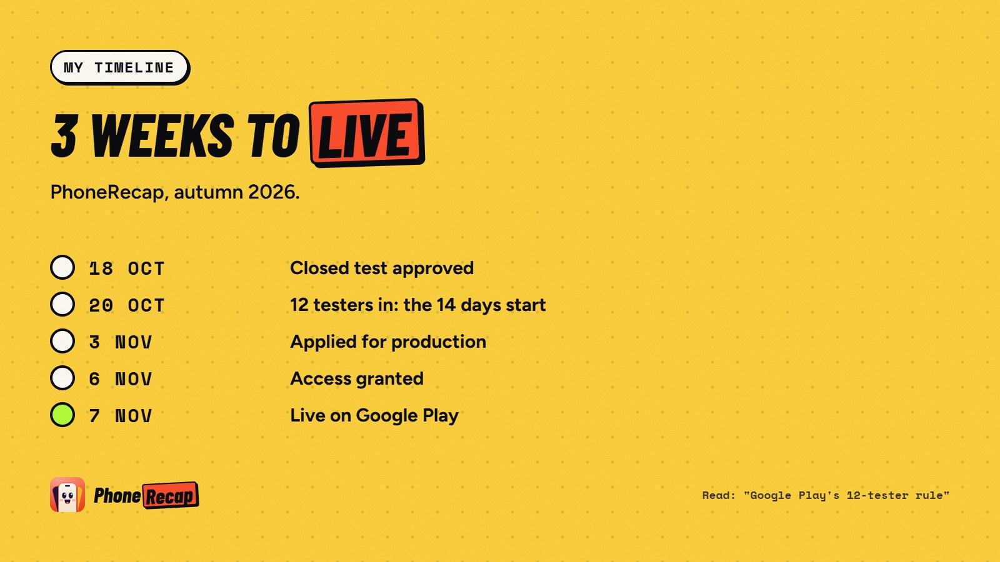

If you made your Google Play developer account after November 2023 as a person (not a company), you can't just
upload your app and hit publish. Google first wants a **closed test with at least 12 testers who stay opted in for
14 days in a row**. Only then can you apply for production.

I just went through this with PhoneRecap (a year-in-review of your phone usage), my second solo Android app. My
first one, GumiGumi, a travel map I built for a hackathon in 2025, had been through closed testing too, so I knew
the drill. PhoneRecap took from 18 October (closed test approved) to 7 November (live on Google Play). Here is what
worked, what I'd do differently, and the checklist I wish I had.

## The rule, in plain words

- Only **closed testing** counts. Internal testing does not.
- **12 opted-in testers**, and they must stay opted in for **14 days in a row**. If someone leaves, the count drops.
- Count the 14 days from the day you have 12, not from the day you create the test.
- After that, Play Console unlocks **"Apply for production"**: a form about your test, your app and your readiness.
  Google answers by email (mine took 3 days).

## Where my testers came from

I posted "I made this, want to test it?" everywhere I'm active, and messaged people directly. More channels worked
than I expected:

- **Reddit: 5+ testers.** The best channel. I posted in r/SideProject and r/betatests with what the app does and a
  feedback question, and people commented to join.
- **Discord: 1–2 testers** from coding communities run by tech teachers who teach on YouTube, like ChaiCode
  (Hitesh Choudhary's community), and similar servers.
- **Instagram: friends.** Mostly Stories, plus one Reel. Friends who saw them showed interest, and I added them.
- **Personal messages** to friends and family, one by one.
- **My previous app's tester list.** I reused GumiGumi's tester email list in Play Console. A friend who was already
  on it could join the new test right away, without me adding anyone.

What I learned: public posts work when you say clearly **what the app is, why you need testers, and exactly how to
join** (one link, three steps). Then reply to every comment fast, because people decide while the post is fresh.

One thing I'd do better: I collected every Gmail address by hand (comments and messages), then typed each one into
the Play Console tester list. That's slow, and people wait. Two easier ways:

- **Use a Google Group as the tester list.** Play Console accepts a Google Group for closed testing: share the
  group's join link with the opt-in link, and anyone who joins the group is a tester. No adding by hand.
- **Or a short Google Form** that asks for the Gmail address, then paste the whole list in one go.

Small things that helped:

- **Make the opt-in link the only link.** Testers join on the web page, then install from Play.
- **Tell them to keep the app installed for 14 days.** Some people uninstall a test app after a look.
- **Check the tester count daily** (Play Console › your closed test › Testers), so you know early if you're short.

My testers ended up in 4 countries (India, Bahrain, Indonesia, US) on Android 11 to 15.

## Use the 14 days: ship updates

The test is not just a waiting room. Testers had other phones and Android versions than my old phone, so they found
bugs I couldn't:

- A details screen showed all-time numbers instead of the chosen day
- The Back button closed the app instead of going back
- Button text was cut off on Android 15
- A monthly "top app" was wrong

I shipped **3 updates during the test**. That also gave me real answers for the production form.

## AI did a lot of the heavy lifting

I'm a solo developer, so I leaned on AI (artificial intelligence) coding assistants, **Claude Code** and **Codex**, the whole way: drafting
the tester posts and messages, writing the store listing and the answers for the production form, and fixing the
bugs testers reported quickly, each fix with a test. They saved me days. I still read every word before it went
out and tested every fix on real phones, because they can be confidently wrong.

## The production form

When the 14 days are done, Play asks things like:

- How did you recruit testers? How easy was it?
- How did testers use the app? What feedback did you get?
- What did you change because of it?
- Who is the app for, and why is it ready?

Each answer is short (around 300 characters). Write them during the test, not at the end: I kept a notes file and
added a line whenever a tester reported something. Be specific: name the bugs and the fixes.

## My checklist

1. Before the closed test: store listing, privacy policy and App content pages done (Play reviews the closed test
   too).
2. Make an email list in Play Console (Gmail addresses only).
3. Post where you're already active (Reddit worked best for me, then Discord coding communities and Instagram Stories) and message friends and family one by one. Aim for 15–20, so you stay above 12 if some leave.
4. Every post and message says: what it is, why you need testers, 3 steps, one link, "keep it 14 days".
5. Let people add themselves: a Google Group as the tester list (or a Google Form), and reuse your previous app's tester list if you have one.
6. Check the tester count every day for the first week.
7. Ship at least one update with tester fixes.
8. Keep a notes file for the production form.
9. Use an AI assistant for drafts and fixes, and check everything it gives you.
10. Apply on day 14+; Google replies by email.

## How it ended

I applied on 3 November, production access came on 6 November, and **PhoneRecap went live on 7 November** in 178
countries.

PhoneRecap turns your Android phone usage into a short year-in-review story (total hours, top apps, your busiest
month, a "phone personality") with monthly recaps and home-screen widgets. It has **no internet permission at all**,
so nothing leaves your phone. If you're curious how the app works with Android's usage data, I wrote about that here:
[How Android stores your screen time](/blog/how-android-stores-screen-time/).

Free, Android 10+: [PhoneRecap on Google Play](https://play.google.com/store/apps/details?id=com.madhavkwatra.phonerecap&referrer=utm_source%3Dblog%26utm_campaign%3Darticle1)

If you're stuck on the 12-tester rule right now, ask in the comments. I'm happy to help.
