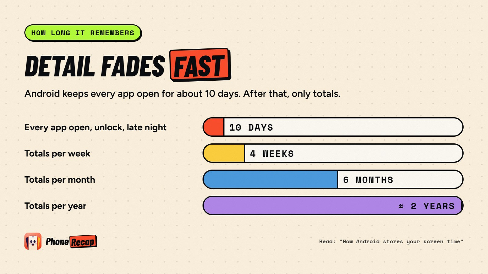
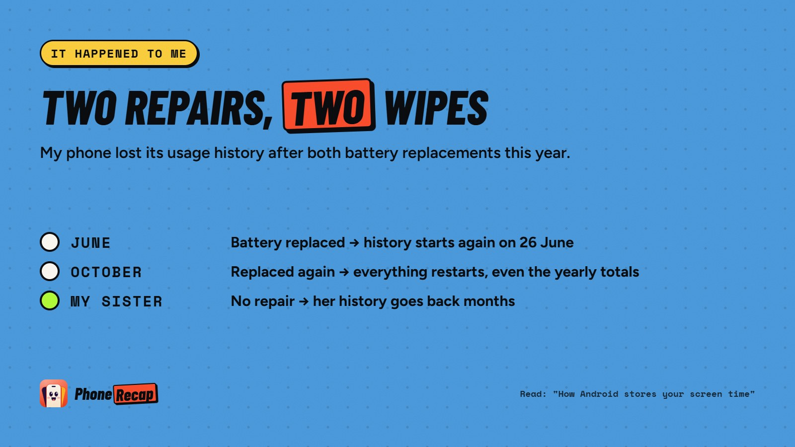
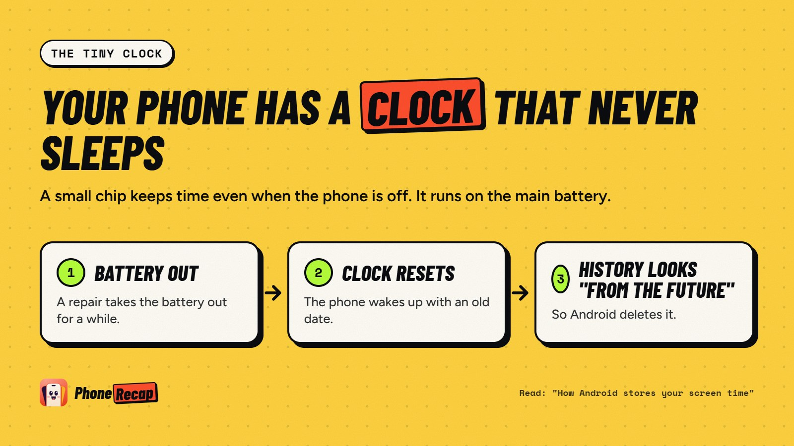
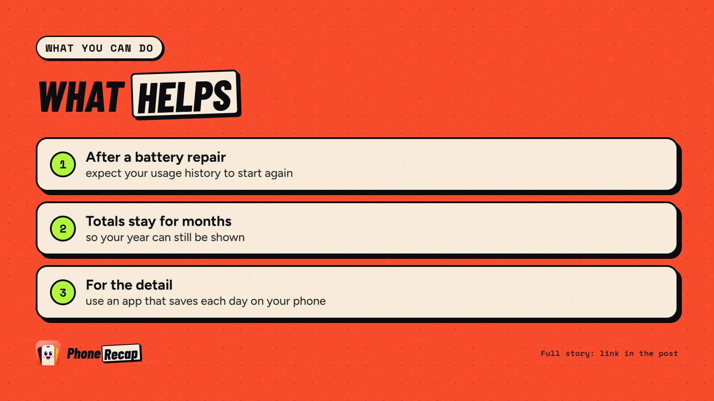

I built PhoneRecap, an Android app that turns your phone usage into a year-in-review story: total hours, top apps,
your busiest month, late nights. To do that I had to learn where Android actually keeps your usage data, how long it
keeps it, and how easily it loses it. My own phone lost its history **twice** this year.

Here is what I learned, from the storage side to the code.

## 1. Where Android keeps your usage data



Android records usage in two very different forms. Apps read both through the `UsageStatsManager` API (application
programming interface), the same source Android's own Digital Wellbeing uses:

**Events** are the detail: an app came to the front, went to the back, the screen turned on, the phone was
unlocked, a notification arrived. With events you can rebuild sessions, unlocks, the hour you're busiest, and your
longest break from the phone.

**Summaries** are totals per app for a time bucket: how long each app was in front, and how often it was opened.

Android keeps them for very different times. These numbers come from the clean-up rules in AOSP (the Android Open
Source Project, the public code Android is built from):

| What                | Kept for about                        |
| ------------------- | ------------------------------------- |
| Events (the detail) | 10 days                               |
| Daily summaries     | 10 days                               |
| Weekly summaries    | 4 weeks                               |
| Monthly summaries   | 6 months                              |
| Yearly summaries    | 2 years (one AOSP change note says 3) |

So a few days back you can see _when_ you used an app. Months back you can only see _how much_, per month.

What this means for a year-in-review:

- **On the day you install it, a recap app can already show most of your year**, from Android's monthly totals:
  total time, top apps, month by month. My sister installed PhoneRecap in October and her recap started in May,
  6 months back, exactly the monthly window.
- **The detail is gone after ~10 days**, so things like "your late nights" or "your longest phone-free break" only
  exist for days the app saved itself. PhoneRecap saves every day into its own database on the phone and labels
  every number "exact" (saved by the app) or "≈" (from Android's totals).

## 2. My phone lost all of it, twice



While testing, my recap always started on 26 June, while my sister's went back months further. Android's own files
on my phone (read with `adb`, the Android Debug Bridge tool for developers) showed why: the daily, weekly, monthly
and yearly data **all began at the same millisecond**, 26 June 12:30. Normal clean-up removes old files one by one;
everything starting at once means the history was **re-created from empty**. That was right after my phone's
battery was replaced.

In October the new battery swelled and was replaced again. Same result: **every bucket restarted at the first boot
after the repair**, the 10 days of detail and the weekly, monthly and yearly totals alike. Android itself had
nothing from before that boot any more.

PhoneRecap survived it because it keeps its own copies: every saved day, and a copy of Android's monthly and yearly
totals since 26 June. Only the ~1.5 days it hadn't saved yet were lost, because they existed only in Android's log.

## 3. Why: the phone's clock



A phone keeps time with an **RTC (real-time clock)**: a tiny circuit that keeps counting even when the phone is off.
It sits in the phone's power chip and runs on the **main battery**. Take the battery out for a repair, and the RTC
forgets the time.

The phone then starts with a **fallback date** until it gets the real time from the network. Which date depends on
the phone and its software: often the date the software was built, sometimes a fixed old date. In October my phone
briefly thought it was 1 January 2010.

Android's usage database doesn't like that. At startup it **deletes files that look like they are from the
future** (it's in the AOSP code), and with the clock in the past, everything you recorded looks like it's from the
future. A power cut that corrupts the database's own files can also make Android wipe it and start over. Which one
hit my phone can't be proven without system logs (my phone's maker turns them off); the result was the same.

Computers have the same weak spot. A PC keeps its clock and BIOS (basic input/output system) settings alive with a
small coin battery, the CMOS (complementary metal-oxide-semiconductor) battery. On my old PC, a 3 GB RAM (random-access
memory) AMD Athlon machine, the date reset on every start and I typed it in by hand. On the PC I bought around 2020,
the date kept falling back to around 2022 and the RAM dropped from 3200 to about 2666 MHz (megahertz), because its speed
profile lives in the same memory. A new coin battery fixed it. A phone has no separate coin battery, so **every
battery replacement is that moment**.

## 4. What I built because of it

- **Save every day.** One row per day in SQLite (a small database built into Android) on the phone, from a daily background job plus every time the app
  opens. A day is safe only once the app has saved it.
- **Honest numbers.** Each card says where its data starts ("since 26 Jun") and whether it's exact or approximate.
- **A warning when saving stops.** Some phones (my vivo; Xiaomi is known for it) stop background work for apps
  they think are idle. The app shows which days it couldn't save and links to the phone's battery setting. A
  home-screen widget helps too: on my vivo its 30-minute refresh wakes the app even after the system stopped it.

## 5. Counting screen time from events: the traps

`UsageStatsManager.queryEvents()` gives you the event stream; you build sessions yourself:

```kotlin
val events = usm.queryEvents(startMs, endMs)
val e = UsageEvents.Event()
while (events.hasNextEvent()) {
  events.getNextEvent(e)
  when (e.eventType) {
    UsageEvents.Event.ACTIVITY_RESUMED -> openSession(e.packageName, e.timeStamp)
    UsageEvents.Event.ACTIVITY_PAUSED  -> closeSession(e.packageName, e.timeStamp)
    UsageEvents.Event.SCREEN_NON_INTERACTIVE -> closeAll(e.timeStamp)
    UsageEvents.Event.KEYGUARD_HIDDEN -> unlocks++
  }
}
```

What bit me:

- **Screen off must close every session.** Some phones send "paused" late or never. Wait for it and the whole night
  counts as Instagram time.
- **An app can be "resumed" while the screen is off.** Count nothing until the screen comes on.
- **A dead battery sends no shutdown event.** The next startup must close whatever was open.
- **Total screen time ≠ the sum of app times.** Split screen puts two apps in front at once; use screen-on time
  for the total.
- **An app already open before your first event** only shows up as "paused". Start it at the oldest event you have,
  not at midnight.
- **Split time at local hour boundaries**, so daylight-saving days and "busiest hour" charts stay right.

Every rule is written at the top of the Kotlin file and has a JUnit test (an automated unit test), because each one was a real bug once.

## 6. No internet permission, for real

PhoneRecap's release build has no INTERNET permission: no backend server, no analytics, no crash-reporting SDK
(software development kit). The app is React
Native + Expo with a Kotlin module, and debug builds need INTERNET for the dev server, so I remove it only in the
release manifest (written by an Expo config plugin):

```xml
<!-- android/app/src/release/AndroidManifest.xml -->
<manifest xmlns:android="http://schemas.android.com/apk/res/android"
          xmlns:tools="http://schemas.android.com/tools">
  <uses-permission android:name="android.permission.INTERNET" tools:node="remove" />
</manifest>
```

Then check the built file, not the source: `aapt2 dump permissions app-release.apk` (aapt2 is Android's
Asset Packaging Tool; the APK is the installable app file) must not list INTERNET (a
library can merge it back in). My release script fails the build if it does. Users can check too: the Play page
shows no "full network access".

## What I'd tell anyone working with usage data



1. Android keeps detail for ~10 days and monthly totals for ~6 months. Plan for both.
2. Save what you need yourself, every day.
3. Expect the history to vanish after a battery replacement or a big clock jump.
4. Label approximate numbers honestly.

If you've found a reliable way to keep background work alive on Xiaomi, vivo or Samsung, I'd love to hear it in the
comments.

PhoneRecap is free on Google Play (Android 10+):
[PhoneRecap on Google Play](https://play.google.com/store/apps/details?id=com.madhavkwatra.phonerecap&referrer=utm_source%3Dblog%26utm_campaign%3Darticle2)
